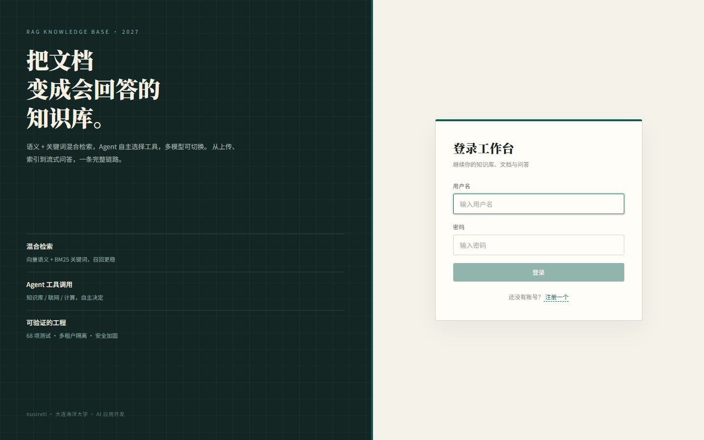
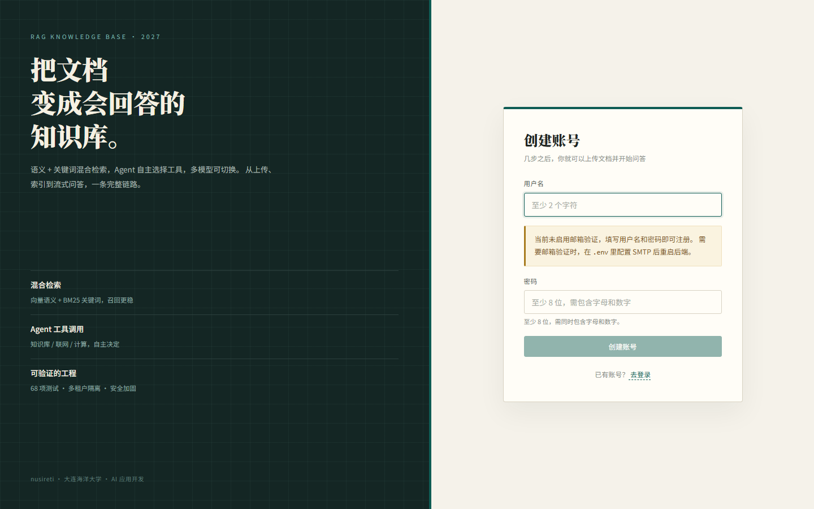
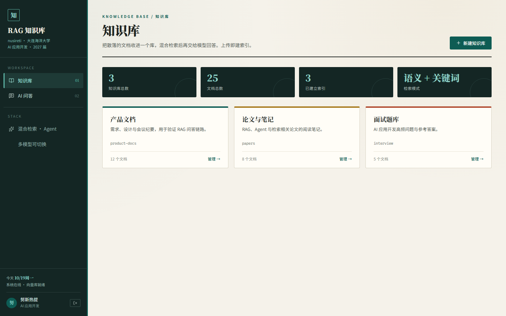
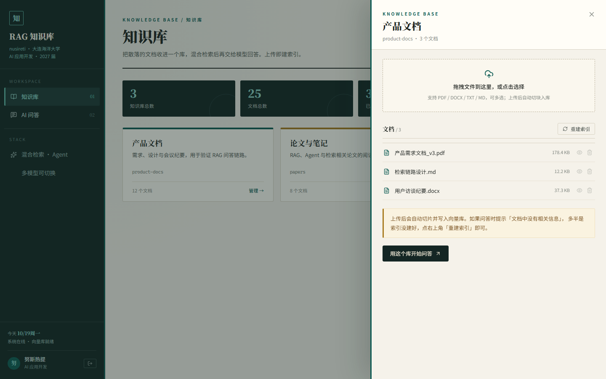
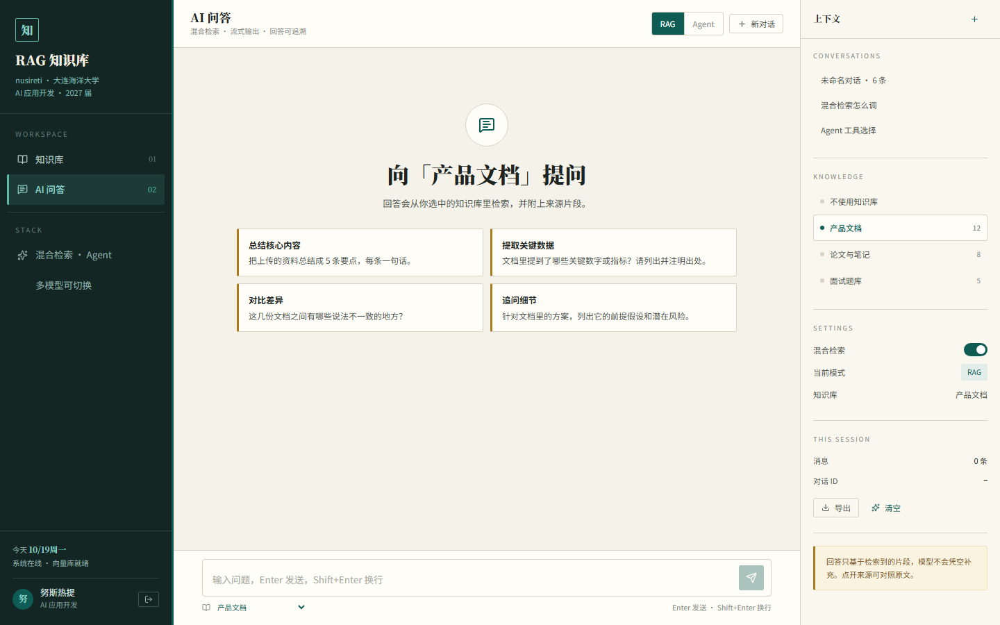
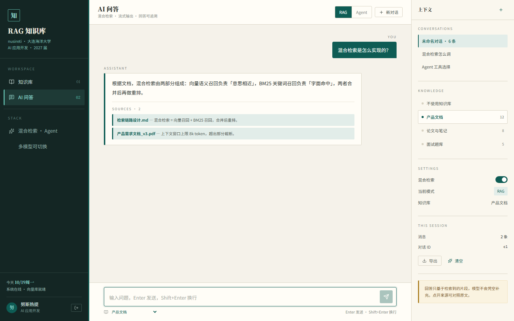

<p align="center">
  
  
  
  
  
  
  
  
  
</p>

<h1 align="center">🧠 RAG 智能知识库</h1>

<p align="center">
  <b>企业级 RAG 知识库问答系统 · v4.2</b><br>
  多用户 · 多知识库 · Agent 工具调用 · 混合检索 · 多模型切换
</p>

<p align="center">
  <i>完全本地运行，数据不出网，保护企业隐私</i>
</p>

<p align="center">
  <b>🧑‍💻 关于作者</b><br>
  计算机专业 AI 方向 · <b>Vibe Coding</b> 实践者 · 独立全栈开发者<br>
  熟练 LangChain / RAG / Agent / 大模型应用开发 · 从架构设计到部署交付一条龙<br>
  <i>"用 AI 构建 AI 产品，让技术真正落地创造价值"</i>
</p>

---

## 📋 项目简介

RAG 智能知识库是一个基于 **LangChain + ChromaDB + Ollama** 的企业级 RAG（检索增强生成）系统。它允许用户上传文档，构建私有知识库，并通过 AI 自然语言问答的方式检索和理解文档内容。

### 核心价值

| 场景 | 说明 |
|------|------|
| 🏢 **企业内部知识管理** | 将公司文档、制度、手册变成可对话的知识库 |
| 🎓 **学术论文分析** | 上传论文 PDF，快速提取关键信息 |
| 📚 **个人学习笔记** | 构建个人知识库，随时检索 |
| 💼 **接单变现** | 知识库搭建（企业 2000+ / 个人 500+） |
| 🎒 **学生课设/毕设** | Python / AI / 数据分析 / 爬虫 等全系列辅导 |

---

## ✨ 功能特性

### 核心功能
- ✅ **多用户登录** — 用户隔离，数据安全
- ✅ **多知识库** — 创建多个独立知识库，一键切换
- ✅ **多格式文档** — 支持 PDF / TXT / Markdown / Word
- ✅ **RAG 问答** — 基于文档内容的精准问答
- ✅ **Agent 模式** — AI 自动选择：知识库检索 / 联网搜索 / 计算器
- ✅ **流式输出** — 文字逐字出现，无需等待
- ✅ **多轮对话** — AI 记住上下文，连续提问
- ✅ **对话导出** — 支持 Markdown / 纯文本导出
- ✅ **混合检索** — BM25 关键词 + 向量语义双路召回，准确率更高
- ✅ **多模型切换** — UI 界面一键切换 Ollama 已安装模型
- ✅ **对话搜索** — 按标题搜索历史对话
- ✅ **Token 统计** — 实时查看 Token 消耗

### 技术特性
- 🔒 **数据安全** — 所有数据本地存储，不上传云端
- 🚀 **GPU 加速** — 自动检测 NVIDIA GPU，推理加速
- 🗄️ **数据库持久化** — SQLAlchemy + SQLite，替代 JSON 文件
- 🐳 **Docker 部署** — 一键 docker-compose up
- 📊 **结构化日志** — 日志文件轮转，生产可用
- 🧪 **测试覆盖** — 93 项 pytest + 前端 lint/build，CI 自动执行
- ⚡ **启动预热** — 后端启动后台加载模型，首问延迟约 2s（原冷启动 ~19s）
- 📝 **Markdown 回答** — 标题 / 列表 / 代码块 / 表格 / 引用正确渲染

---

## 🖥 界面预览

<table>
  <tr>
    <td width="50%"></td>
    <td width="50%"></td>
  </tr>
</table>









---

## 🚀 快速开始

### 环境要求

- Python 3.10+
- Node.js 20+
- [Ollama](https://ollama.com/)（本地模型）或任一 OpenAI 兼容 API
- 推荐：NVIDIA GPU（可选，CPU 也可运行）

### 安装与启动

```bash
# 1. 后端
pip install -r requirements.txt
cp .env.example .env          # 填 SECRET_KEY；云端模型再填对应 Key
python -m uvicorn backend.main:app --reload --port 8000

# 2. 前端（另开一个终端）
cd frontend
npm install
npm run dev                   # http://localhost:5173
```

打开 **http://localhost:5173**，注册账号即可使用。

> 首次启动会自动建表；生产环境建议走 Alembic 迁移（见「数据库迁移」）。
> 旧版 Streamlit 入口仍保留（`python run.py web`，端口 8501），已归档。

---

## 📁 项目结构

```
rag-knowledge-base/
├── app/                          # 核心应用包
│   ├── config.py                 # pydantic-settings 配置
│   ├── database.py               # SQLAlchemy 数据库
│   ├── models.py                 # ORM 模型（5 张表）
│   ├── auth.py                   # 用户认证（bcrypt + Session）
│   ├── ratelimit.py              # 滑动窗口限流（纯 ASGI）
│   ├── logger.py                 # 结构化日志
│   ├── exceptions.py             # 异常体系
│   ├── rag/                      # RAG 引擎
│   │   ├── engine.py             # 问答引擎（含延迟埋点）
│   │   ├── hybrid.py             # 向量 + BM25 + Reranker
│   │   ├── ingest.py             # 文档导入
│   │   ├── embed.py              # Embedding 管理
│   │   └── loaders.py            # 文档加载器
│   └── web/
│       └── ui.py                 # 旧版 Streamlit 界面（已归档）
│
├── backend/                      # FastAPI 后端
│   ├── main.py                   # 入口：CORS / 限流 / 健康检查
│   └── api/                      # auth / knowledge_bases / documents / chat / models
│
├── frontend/                     # React 19 + TypeScript + Vite + Tailwind 4
│   └── src/                      # 页面、布局、组件、SSE 解析
│
├── alembic/                      # 数据库迁移
│   └── versions/                 # 迁移脚本
│
├── scripts/                      # 运维脚本
│   ├── init_db.py                # 初始化数据库
│   ├── create_admin.py           # 创建管理员
│   └── backup.py                 # 数据备份
│
├── tests/                        # 73 项测试
├── docs/images/                  # 界面截图
├── docker/                       # Docker 部署
├── .env.example                  # 环境变量模板
├── requirements.txt
├── run.py                        # 统一入口
└── README.md
```

---

## ⚙️ 配置说明

所有配置通过环境变量或 `.env` 文件管理：

```bash
# 复制配置模板
cp .env.example .env

# 修改配置（按需）
EMBEDDING_PROVIDER=local          # local | openai
LLM_PROVIDER=local                # local | openai
OLLAMA_MODEL=qwen2.5:3b
LLM_TEMPERATURE=0.1
CHUNK_SIZE=1000
RETRIEVAL_K=6
```

---

## 🧠 技术栈

| 层级 | 技术选型 |
|------|---------|
| **LLM 引擎** | Ollama + Qwen2.5 / DeepSeek / LLaMA |
| **RAG 框架** | LangChain (LCEL) |
| **向量数据库** | ChromaDB |
| **Embedding** | BAAI/bge-small-zh-v1.5 |
| **Web 界面** | Streamlit |
| **数据库** | SQLAlchemy + SQLite |
| **认证** | bcrypt + HMAC Session |
| **部署** | Docker + docker-compose |
| **文档加载** | PyMuPDF / python-docx / Unstructured |

---

## 🔌 支持的 LLM 模型

| 模型 | 大小 | 速度 | 中文 | 推荐场景 |
|------|------|------|------|---------|
| `qwen2.5:3b` | 1.9GB | ⚡⚡⚡ | ✅ 优秀 | **推荐**，平衡速度与质量 |
| `qwen2.5:1.5b` | 1.1GB | ⚡⚡⚡⚡ | ✅ 良好 | 轻量快速 |
| `deepseek-r1:7b` | 4.7GB | ⚡ | ✅ 良好 | 数学/逻辑推理 |
| `qwen2.5:7b` | 4.0GB | ⚡⚡ | ✅ 优秀 | 高质量但较慢 |
| `gpt-4o-mini` | API | ⚡⚡⚡⚡ | ✅ 优秀 | 需要 API Key |

---

## 📊 数据库模型

系统使用 SQLAlchemy ORM，包含 5 个核心模型：

```
User (用户)
  ├── KnowledgeBase (知识库) — 用户创建的独立知识库
  │   ├── Document (文档) — 上传的源文件
  │   └── Conversation (对话) — 问答记录
  │       └── Message (消息) — 每条问答内容
  └── Conversation (对话)
```

### 数据库迁移（Alembic）

```bash
# 空库：直接建到最新
alembic upgrade head

# 已有库（表由 create_all 建的）：先打基线，避免重复建表
alembic stamp head

# 改完模型后生成新迁移
alembic revision --autogenerate -m "describe change"
```

迁移脚本在 `alembic/versions/`；数据库 URL 从 `app.config.settings` 读取，
可用 `DATABASE_URL` 环境变量覆盖。

### 数据备份

```bash
python scripts/backup.py                 # 写到 backups/，保留最近 7 份
python scripts/backup.py --keep 14
python scripts/backup.py --out D:/backups
```

备份内容：`data/rag.db`（SQLite 在线一致性快照）、`knowledge_bases/`、`conversations/`。

---

## 🐳 Docker 部署

```bash
cd docker

# 启动全部服务（Ollama + RAG 应用）
docker-compose up -d

# 查看日志
docker-compose logs -f

# 停止
docker-compose down
```

---

## 🔐 安全特性

- **bcrypt 密码哈希** — 12 轮迭代，抗暴力破解
- **HMAC 签名 Session** — 防止 Token 伪造
- **用户数据隔离** — 知识库、文档、对话按用户分离
- **接口限流** — 认证 30 次/分、问答 20 次/分（按 IP 滑动窗口）
- **健康检查** — `/api/health` 同时检查 API、数据库与知识库目录
- **数据本地存储** — 不依赖任何第三方云服务
- **可配置 SECRET_KEY** — 生产环境必须替换

---

## 🧪 测试

```bash
# 运行全部测试（当前 93 项）
python -m pytest tests/ -q

# 运行特定测试
python -m pytest tests/test_auth.py -v
```

覆盖认证、越权、XSS/路径穿越、限流、备份、迁移基线等。

CI 在每次 push / PR 自动运行后端 pytest + 前端 ESLint/build，
配置见 `.github/workflows/ci.yml`。

---

## 📌 版本规划

| 版本 | 内容 | 状态 |
|------|------|------|
| v1.0 | 基础 RAG 功能 | ✅ |
| v2.0 | 多知识库、Agent 模式、流式输出 | ✅ |
| v3.0 | 用户认证、数据库持久化、Docker 部署 | ✅ |
| v4.0 | 多模型接入 + FastAPI/React 前端 | ✅ |
| v4.1 | 混合检索（BM25 + Reranker） | ✅ |
| v4.2 | 工程化：Alembic / 限流 / 健康检查 / 备份 / 93 项测试 | ✅ |
| v5.0 | 多模态（图片/语音）、开放 API | 📅 规划中 |

---

## 📄 开源协议

[MIT License](./LICENSE)

---

## 🙏 致谢

- 项目由计算机专业学生独立开发完成
- 感谢 LangChain、ChromaDB、Streamlit、Ollama、HuggingFace 等开源社区

---

<p align="center">
  <sub>Made with ❤️ · Built by <b>Vibe Coding</b> · 计算机专业 AI 方向 · 独立开发者</sub>
</p>
